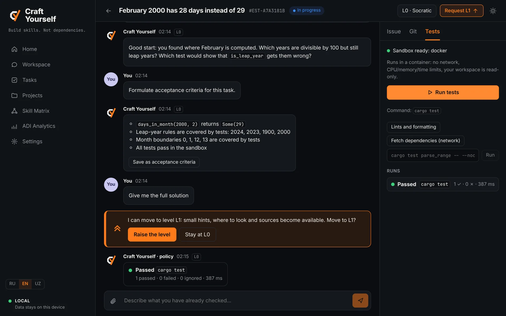
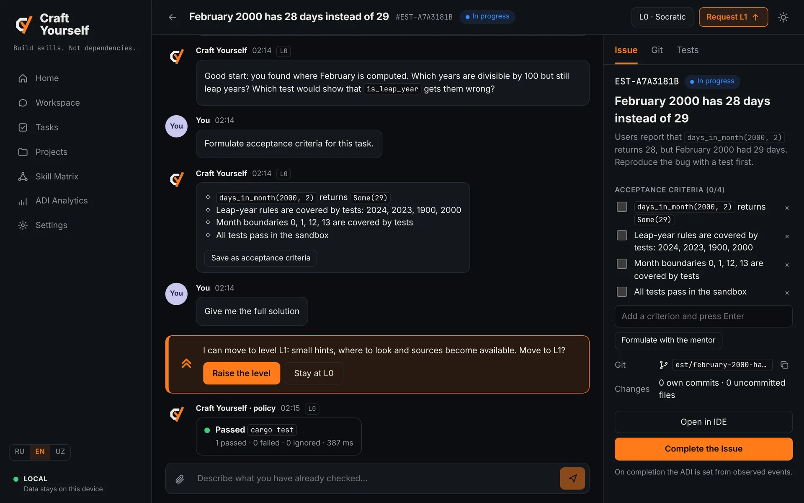

<p align="center"></p>

<p align="center"><b>English</b> · <a href="README.ru.md">Русский</a> · <a href="README.uz.md">O‘zbekcha</a></p>

# Craft Yourself

An open-source trainer for engineering skills. You work on real projects and
Issues in your own IDE; a chat mentor **helps you reason instead of solving the
task for you**.

> **Build skills. Not dependencies.**

Architecture: [`docs/architecture.md`](docs/architecture.md) (spec v0.3) ·
Plan: [`ROADMAP.md`](ROADMAP.md) · For AI agents: [`AGENTS.md`](AGENTS.md) ·
Interface concepts: [`docs/design/`](docs/design)

## Screenshots

**Home: learning programs.** The first program is available, the rest are coming soon.


**An Issue in the chat.** At L0 the mentor asks questions and formulates acceptance criteria; a request for the full solution is blocked and a one-step escalation is proposed; tests ran in the Docker sandbox.



<table>
<tr>
<td width="50%"><b>Acceptance criteria</b> saved from the mentor's answer, with a checklist.<br></td>
<td width="50%"><b>Boundary-values trainer</b> in an isolated frame: the wrong expectation for 5000 is caught.<br></td>
</tr>
<tr>
<td colspan="2"><b>Engineering Skill Matrix</b> in the light theme: untested skills are “not assessed”, not zero.<br></td>
</tr>
</table>

## What works today

- **Learning programs.** A home page with program tiles. The first program,
  *Tests: running and quality*, has reading lessons, server-graded quizzes, an
  interactive boundary-values trainer in a sandboxed iframe and a practice
  project (a regression test, red → green) run in the sandbox. Six more
  programs are listed as *coming soon*.
- **Problem analysis (LeetCode, Codeforces).** Paste a problem's link,
  statement and samples and pick Python, C++ or Rust: you get a workspace
  with a solution template, the samples run in the sandbox, and the mentor
  guides you through the statement, examples, idea, complexity and edge
  cases — starting at L0, with questions instead of the answer. Nothing is
  downloaded from the judge.
- **Recommendations.** The connected model suggests next steps from your
  activity: programs to finish, Issues to continue, problems on Codeforces
  or LeetCode by topic and rating, programs to generate. It sees only
  aggregates and titles — never your messages or code — and you can see
  exactly what is sent.
- **Session summaries and Knowledge Profile.** When an Issue is completed or
  abandoned, the code writes a summary of the session from observed events:
  help levels, tests in the sandbox, acceptance criteria, own commits, the
  final ADI and signals such as *on your own* or *fixed failing tests*. The
  Knowledge Profile aggregates them per discipline, problem tag and task type
  (*independent*, *developing*, *needs practice*) and feeds the
  recommendations. It is advice, not a grade: ADI and the Skill Matrix stay
  independent.
- **Programs generated on request.** Name a topic, level and number of
  lessons; the connected model plans the program and writes reading lessons,
  interactive HTML5 pages and quizzes. Answers are validated in code before
  they are stored, quizzes are graded on the server, and progress is tracked
  like in the built-in programs.
- **Live answers.** The mentor's answer appears as the model writes it.
  Only text the policy never removes is shown early: code blocks and HTML
  pages are withheld until the whole answer has been checked.
- **Formulas and pages from the model.** LaTeX (`$…$`, `$$…$$`) is rendered
  with KaTeX in lessons, quizzes and the chat. An HTML5 page the mentor
  attaches (a ```` ```html ```` block) is shown in an isolated frame without
  network access or access to the app; the policy allows one page per answer
  from level L2 and removes pages below it. Animations, canvas, forms and
  in-page messages work; storage lasts while the page is open.
- **Projects and workspaces.** Connect a local Git repository (or clone a
  remote one); languages and license are detected; every Issue gets its own
  directory and branch in `~/.est/workspaces` and opens in your editor.
- **Sandbox.** Tests, checks and custom commands run in Docker or Podman: no
  network unless you allow it for a run, CPU/memory/process/time limits, all
  capabilities dropped, a read-only root filesystem, and your workspace mounted
  read-only. Results appear in the chat and in the Tests tab.
- **Chat-first mentor with engagement levels L0–L4.** Every new Issue starts at
  L0 (Socratic). A request above the current level is blocked and the mentor
  proposes raising it by **one** step; nothing is unlocked without consent.
  At L0 the mentor still formulates **acceptance criteria** and **translates**
  text. Limits are enforced in code: excess code is removed from answers.
- **Documentation boundary.** Questions about concrete APIs never reach the
  model: the answer is a set of links to the definition in the source code, the
  task's documentation and the API reference.
- **AI Gateway.** Claude, ChatGPT, Gemini, DeepSeek, Kimi and Qwen by API
  key, coding-plan subscriptions (Kimi Code, Qwen Coding Plan), local Ollama
  or any OpenAI-compatible API — connected and switched in *Settings → AI
  providers*. Remote providers must use https; keys stay on the device
  (`~/.est/secrets`, owner-only) or come from an environment variable.
- **ADI and Skill Matrix.** The AI Dependency Index of each completed Issue is
  computed from observed events and averaged with double decay (30 days /
  10 Issues). The Engineering Skill Matrix scores skills from observed
  evidence — quiz attempts, trainer results, completed practice and Issues
  (tests, acceptance criteria, help levels) — with a status, confidence,
  dimensions (theory, practice, diagnosis, independence) and the evidence
  history. Reading is not evidence, and untested skills are *not assessed*,
  never zero. The two are independent: the ADI is not an input.
- **Desktop app (Tauri)** for Linux, Windows and macOS; the same interface also runs in a browser.
- **Interface in Russian, English and Uzbek**; dark and light themes.
- **Privacy.** Data stays local; export your whole history as JSON; delete a
  conversation together with its events and the Issue's ADI.

Not yet: Session Summary and Knowledge Profile, loading problem statements from the judge, evidence-based skill
assessment, commit and PR review, the other learning programs. See the
[roadmap](ROADMAP.md).

## Quick start

Craft Yourself is a **desktop app** built with [Tauri](https://tauri.app): one
window that contains the local daemon (database, sandbox, mentor) and the
interface. You need Rust ≥ 1.90, `git`, Node.js 22 and, to run tests in the
sandbox, Podman or Docker. On Linux, Tauri also needs WebKitGTK:
`sudo apt install libwebkit2gtk-4.1-dev libgtk-3-dev libsoup-3.0-dev librsvg2-dev`.

```sh
(cd frontend && npm ci && npm run build)          # the interface is embedded into the app
cargo run --release --manifest-path apps/desktop/Cargo.toml
```

Installers (`.deb`, `.AppImage`, `.msi`, `.dmg`): `cargo install tauri-cli --version "^2"`,
then `cargo tauri build` in `apps/desktop`.

Pick the *Tests* program on the home page and start with the first lesson.

Without a desktop session (a server, WSL), the same daemon serves the
interface in a browser: `cargo run -p est-cli -- serve` → http://127.0.0.1:7878. Connect a model in *Settings → AI providers*, or add to `~/.est/config/config.toml`:

```toml
[llm]
base_url = "http://127.0.0.1:11434/v1"   # Ollama
model = "qwen2.5-coder:7b"
```

### CLI

```sh
est project add ~/src/my-project
est task import exercises/examples/globset-escape-roundtrip.toml
est task start <id> --open          # workspace + editor
cd "$(est workspace path)"
est chat "I found the escape function, what should I check next?"
est escalation accept               # or reject
est test                            # run tests in the sandbox
est task complete <id>              # final ADI
est adi
est data export --output history.json
```

## Development

```sh
cargo test --workspace
cargo clippy --workspace --all-targets -- -D warnings
cargo fmt --all
cd frontend && npm run dev           # http://localhost:5173 → API on :7878
cd apps/desktop && cargo clippy -- -D warnings   # desktop app (needs WebKitGTK)
EST_SANDBOX_IT=1 cargo test -p est-sandbox   # real-container isolation test
```

## License

The [LICENSE](LICENSE) file is GPL-3.0. Spec v0.3 lists the project license
as TBD; the final choice belongs to the repository owner.
