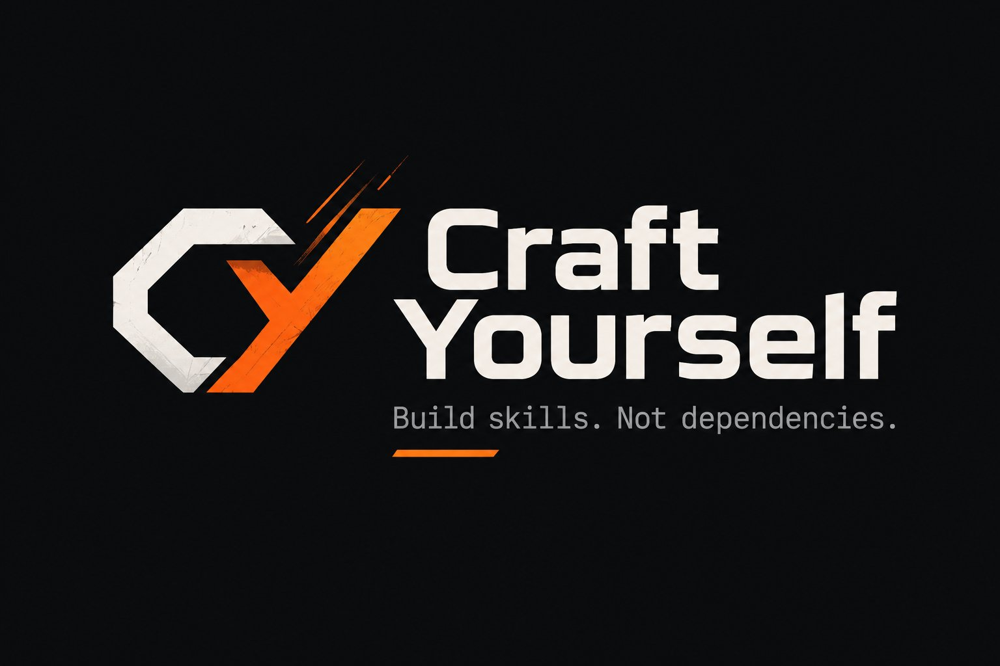
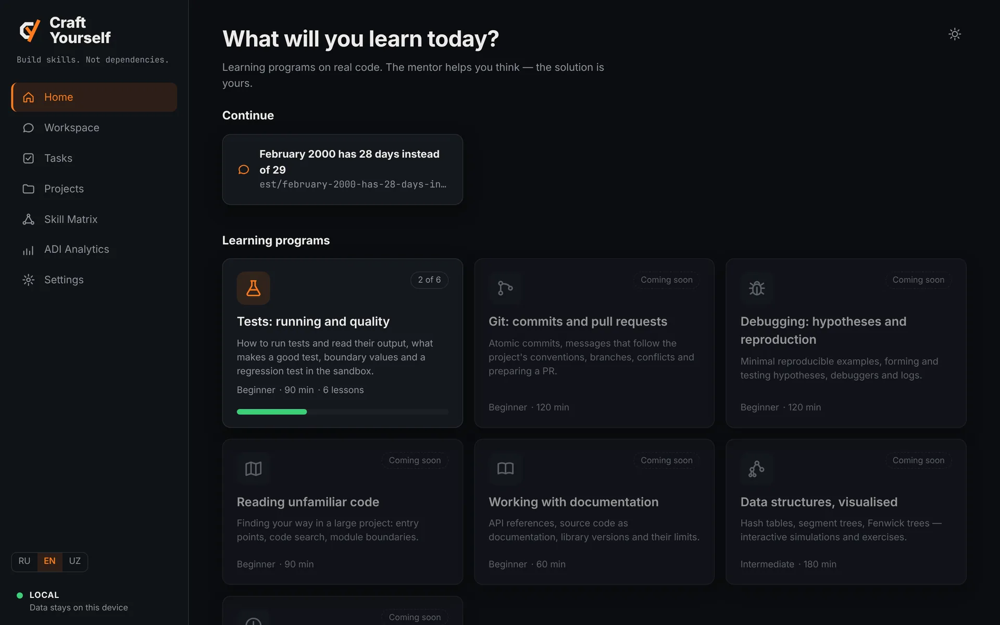
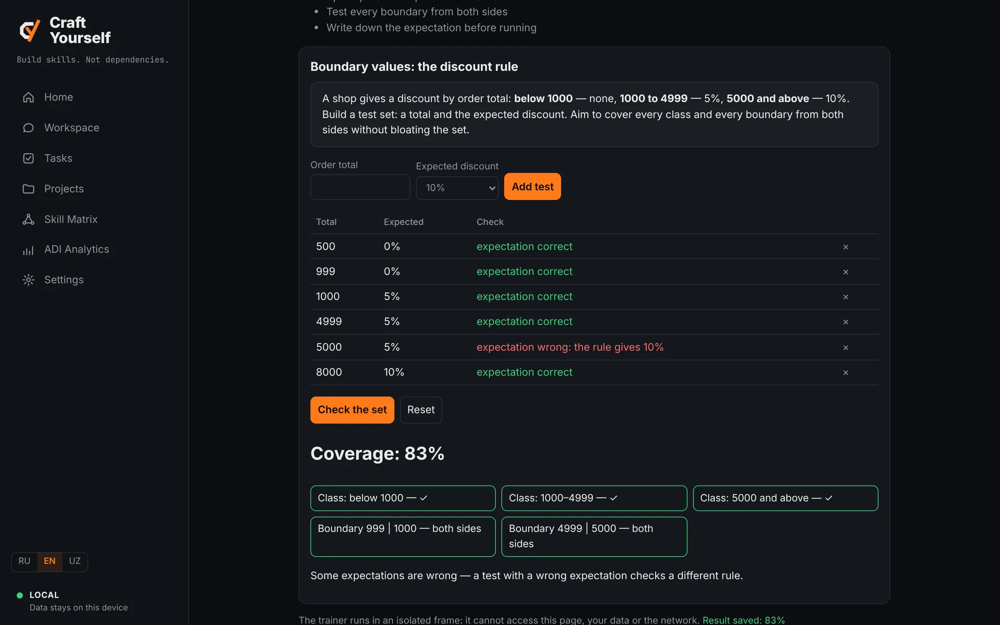
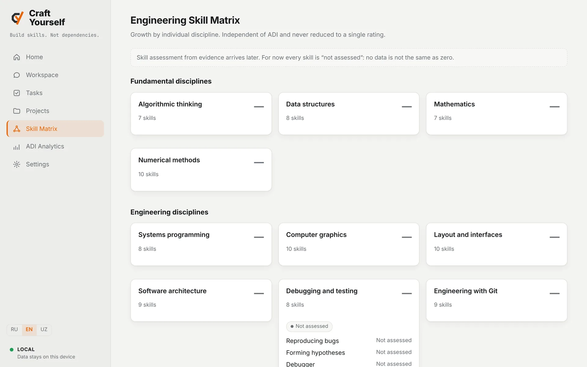

<p align="center"></p>

<p align="center"><b>English</b> · <a href="README.ru.md">Русский</a> · <a href="README.uz.md">O‘zbekcha</a></p>

# Craft Yourself

An open-source trainer for engineering skills. You work on real projects and
Issues in your own IDE; a chat mentor **helps you reason instead of solving the
task for you**.

> **Build skills. Not dependencies.**

Architecture: [`docs/architecture.md`](docs/architecture.md) (spec v0.3) ·
Plan: [`ROADMAP.md`](ROADMAP.md) · For AI agents: [`AGENTS.md`](AGENTS.md) ·
Interface concepts: [`docs/design/`](docs/design)

## Screenshots

**Home: learning programs.** The first program is available, the rest are coming soon.



**An Issue in the chat.** At L0 the mentor asks questions and formulates acceptance criteria; a request for the full solution is blocked and a one-step escalation is proposed; tests ran in the Docker sandbox.


<table>
<tr>
<td width="50%"><b>Acceptance criteria</b> saved from the mentor's answer, with a checklist.<br></td>
<td width="50%"><b>Boundary-values trainer</b> in an isolated frame: the wrong expectation for 5000 is caught.<br></td>
</tr>
<tr>
<td colspan="2"><b>Engineering Skill Matrix</b> in the light theme: untested skills are “not assessed”, not zero.<br></td>
</tr>
</table>

## What works today

- **Learning programs.** A home page with program tiles. The first program,
  *Tests: running and quality*, has reading lessons, server-graded quizzes, an
  interactive boundary-values trainer in a sandboxed iframe and a practice
  project (a regression test, red → green) run in the sandbox. Six more
  programs are listed as *coming soon*.
- **Projects and workspaces.** Connect a local Git repository (or clone a
  remote one); languages and license are detected; every Issue gets its own
  directory and branch in `~/.est/workspaces` and opens in your editor.
- **Sandbox.** Tests, checks and custom commands run in Docker or Podman: no
  network unless you allow it for a run, CPU/memory/process/time limits, all
  capabilities dropped, a read-only root filesystem, and your workspace mounted
  read-only. Results appear in the chat and in the Tests tab.
- **Chat-first mentor with engagement levels L0–L4.** Every new Issue starts at
  L0 (Socratic). A request above the current level is blocked and the mentor
  proposes raising it by **one** step; nothing is unlocked without consent.
  At L0 the mentor still formulates **acceptance criteria** and **translates**
  text. Limits are enforced in code: excess code is removed from answers.
- **Documentation boundary.** Questions about concrete APIs never reach the
  model: the answer is a set of links to the definition in the source code, the
  task's documentation and the API reference.
- **AI Gateway.** Any OpenAI-compatible endpoint: local Ollama, the llama.cpp
  server or a remote API (https only; the key comes from an environment
  variable).
- **ADI and Skill Matrix.** The AI Dependency Index of each completed Issue is
  computed from observed events and averaged with double decay (30 days /
  10 Issues). The Engineering Skill Matrix shows untested skills as
  *not assessed*, never as zero. The two are independent.
- **Interface in Russian, English and Uzbek**; dark and light themes.
- **Privacy.** Data stays local; export your whole history as JSON; delete a
  conversation together with its events and the Issue's ADI.

Not yet: Session Summary and Knowledge Profile, evidence-based skill
assessment, commit and PR review, the other learning programs. See the
[roadmap](ROADMAP.md).

## Quick start

You need Rust ≥ 1.85, `git`, Node.js 22 (for the interface) and, to run tests
in the sandbox, Podman or Docker.

```sh
cargo build --release
(cd frontend && npm ci && npm run build)

./target/release/est init                    # ~/.est and config.toml
./target/release/est serve                   # http://127.0.0.1:7878
```

Open the address, pick the *Tests* program on the home page and start with
the first lesson. To connect a model, add to `~/.est/config/config.toml`:

```toml
[llm]
base_url = "http://127.0.0.1:11434/v1"   # Ollama
model = "qwen2.5-coder:7b"
```

### CLI

```sh
est project add ~/src/my-project
est task import exercises/examples/globset-escape-roundtrip.toml
est task start <id> --open          # workspace + editor
cd "$(est workspace path)"
est chat "I found the escape function, what should I check next?"
est escalation accept               # or reject
est test                            # run tests in the sandbox
est task complete <id>              # final ADI
est adi
est data export --output history.json
```

## Development

```sh
cargo test --workspace
cargo clippy --workspace --all-targets -- -D warnings
cargo fmt --all
cd frontend && npm run dev           # http://localhost:5173 → API on :7878
EST_SANDBOX_IT=1 cargo test -p est-sandbox   # real-container isolation test
```

## License

The [LICENSE](LICENSE) file is GPL-3.0. Spec v0.3 lists the project license
as TBD; the final choice belongs to the repository owner.
