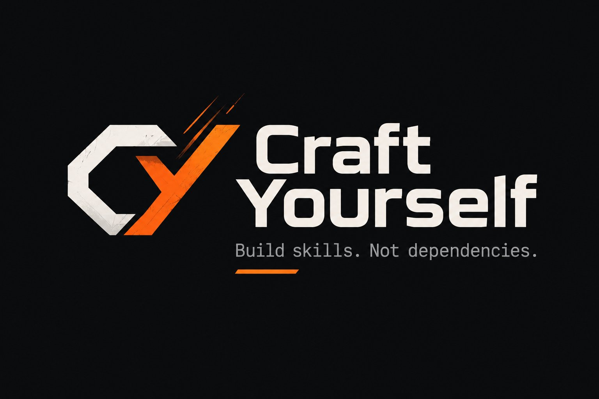

<p align="center"></p>

<p align="center"><a href="README.md">English</a> · <b>Русский</b> · <a href="README.uz.md">O‘zbekcha</a></p>

# Craft Yourself

Open-source тренажёр инженерных навыков: реальные проекты и Issues, ваша
IDE, чат с ИИ-наставником, который **помогает рассуждать, а не решает за вас**.

> **Build skills. Not dependencies.**

Архитектура: [`docs/architecture.md`](docs/architecture.md) (ТЗ v0.3) ·
План: [`ROADMAP.md`](ROADMAP.md) · Для ИИ-агентов: [`AGENTS.md`](AGENTS.md) ·
Концепты интерфейса: [`docs/design/`](docs/design)

## Что уже работает

- **Обучающие программы.** Главная страница с плитками программ. Первая
  программа — «Тесты: запуск и качество»: теория, проверочные вопросы с
  проверкой на сервере, интерактивный тренажёр граничных значений в
  изолированном iframe и практический проект (регрессионный тест, красный →
  зелёный) с запуском в песочнице. Ещё шесть программ отмечены как «скоро».
- **Проекты и рабочие каталоги.** Подключение локального Git-репозитория (или
  клонирование удалённого), определение языков и лицензии, отдельный каталог
  и ветка на каждую Issue в `~/.est/workspaces`, открытие в вашем редакторе.
- **Песочница.** Тесты, проверки и свои команды выполняются в Docker или
  Podman: без сети, пока вы не разрешите её для запуска, с лимитами CPU,
  памяти, процессов и времени, без capabilities, с корневой ФС только для
  чтения; ваш рабочий каталог монтируется только для чтения. Результаты видны
  в чате и на вкладке «Тесты».
- **Chat-first ментор и уровни L0–L4.** Каждая новая Issue начинается с L0
  (сократический). Запрос выше текущего уровня блокируется, и ментор предлагает
  подняться на **одну** ступень; без согласия ничего не открывается. На L0
  ментор всё равно формулирует **критерии приёмки** и **переводит** текст.
  Ограничения проверяются кодом: лишний код вырезается из ответа.
- **Documentation Boundary.** Вопросы о конкретных API не уходят в модель:
  ответ — ссылки на определение в исходниках, документацию задачи и API Reference.
- **AI Gateway.** Любой OpenAI-совместимый endpoint: локальная Ollama,
  llama.cpp server или внешний API (только https, ключ — из переменной окружения).
- **ADI и Skill Matrix.** Индекс зависимости от ИИ по каждой завершённой Issue
  считается по наблюдаемым событиям и усредняется с двойным затуханием
  (30 дней / 10 Issue). Engineering Skill Matrix показывает непроверенный навык
  как «не оценено», а не 0. Они независимы.
- **Интерфейс на русском, английском и узбекском**; тёмная и светлая темы.
- **Приватность.** Данные локально; экспорт всей истории в JSON; удаление
  диалога вместе с событиями и ADI задачи.

Пока нет: Session Summary и Knowledge Profile, оценки навыков по evidence,
проверки коммитов и PR, остальных программ обучения. См. [ROADMAP.md](ROADMAP.md).

## Быстрый старт

Нужны Rust ≥ 1.85, `git`, Node.js 22 (для интерфейса) и, для запуска тестов в
песочнице, Podman или Docker.

```sh
cargo build --release
(cd frontend && npm ci && npm run build)

./target/release/est init                    # ~/.est и config.toml
./target/release/est serve                   # http://127.0.0.1:7878
```

Откройте адрес, выберите на главной программу «Тесты» и начните с первого
урока. Модель подключается в `~/.est/config/config.toml`:

```toml
[llm]
base_url = "http://127.0.0.1:11434/v1"   # Ollama
model = "qwen2.5-coder:7b"
```

### CLI

```sh
est project add ~/src/my-project
est task import exercises/examples/globset-escape-roundtrip.toml
est task start <id> --open          # рабочий каталог + IDE
cd "$(est workspace path)"
est chat "Нашёл функцию escape, что проверить дальше?"
est escalation accept               # или reject
est test                            # тесты в песочнице
est task complete <id>              # финальный ADI
est adi
est data export --output history.json
```

## Разработка

```sh
cargo test --workspace
cargo clippy --workspace --all-targets -- -D warnings
cargo fmt --all
cd frontend && npm run dev           # http://localhost:5173 → API на :7878
EST_SANDBOX_IT=1 cargo test -p est-sandbox   # проверка изоляции на реальном контейнере
```

## Лицензия

Файл [LICENSE](LICENSE) — GPL-3.0. В ТЗ v0.3 лицензия проекта отмечена как
TBD; окончательный выбор за владельцем репозитория.
