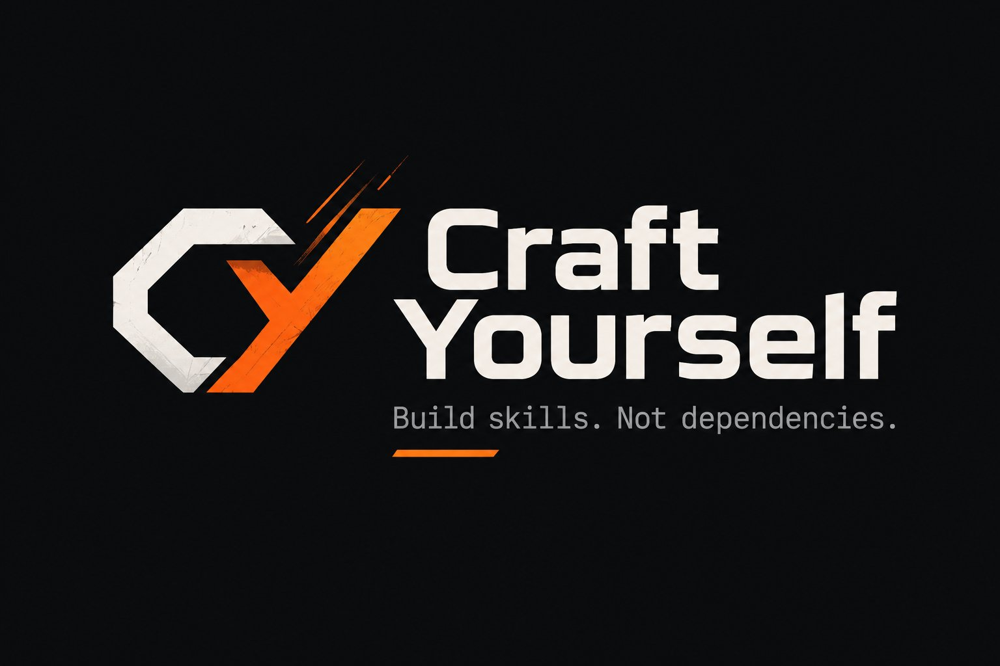
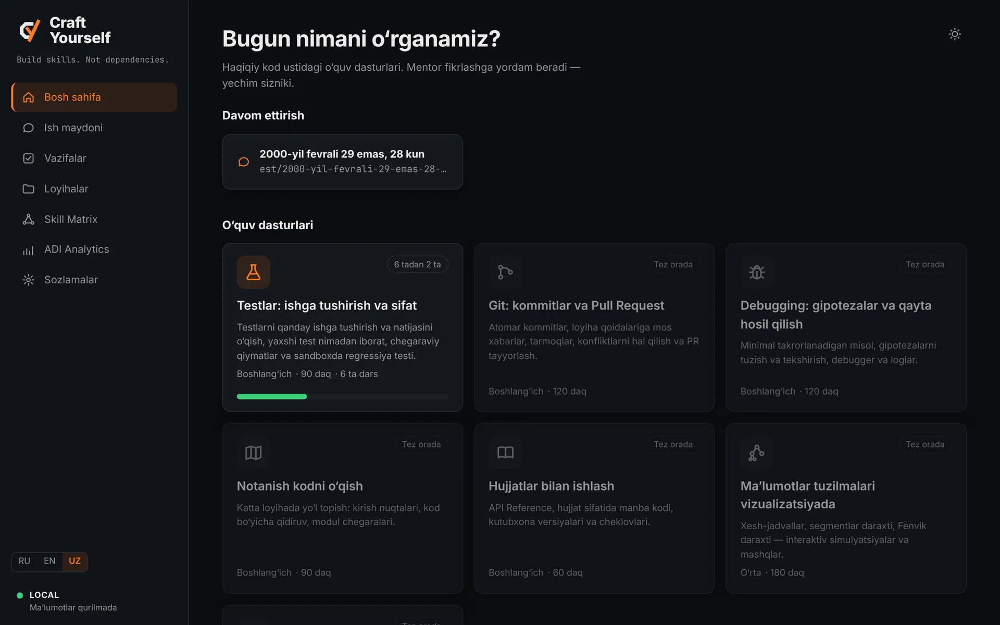
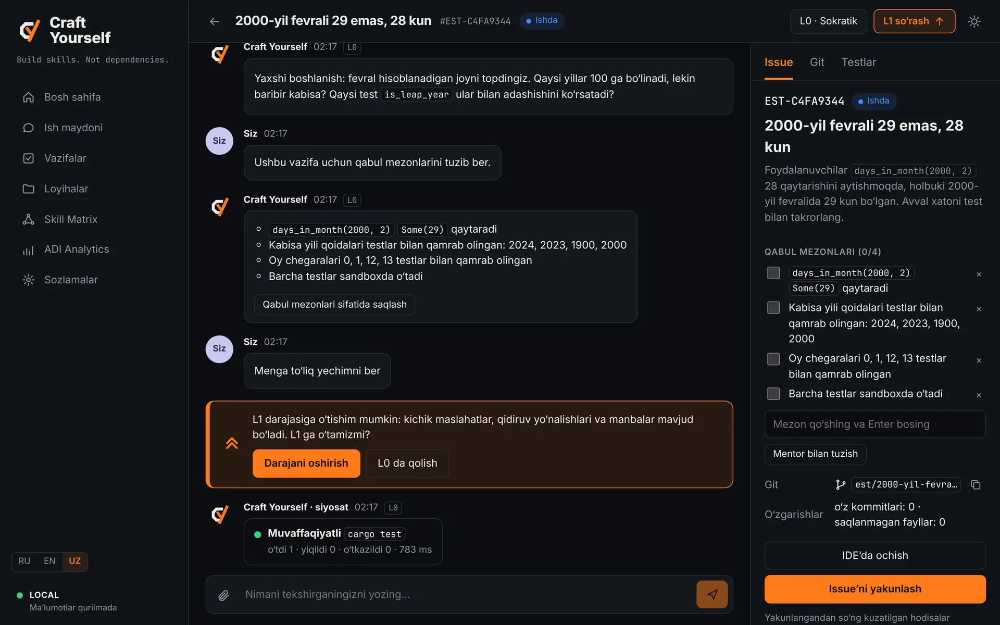
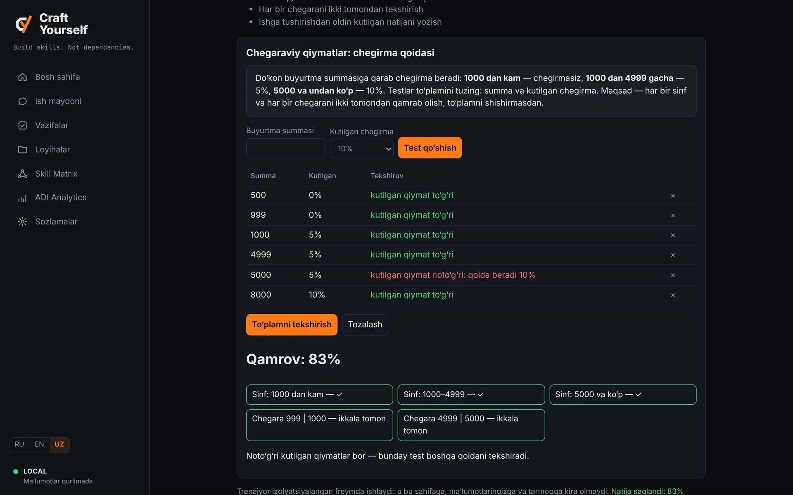
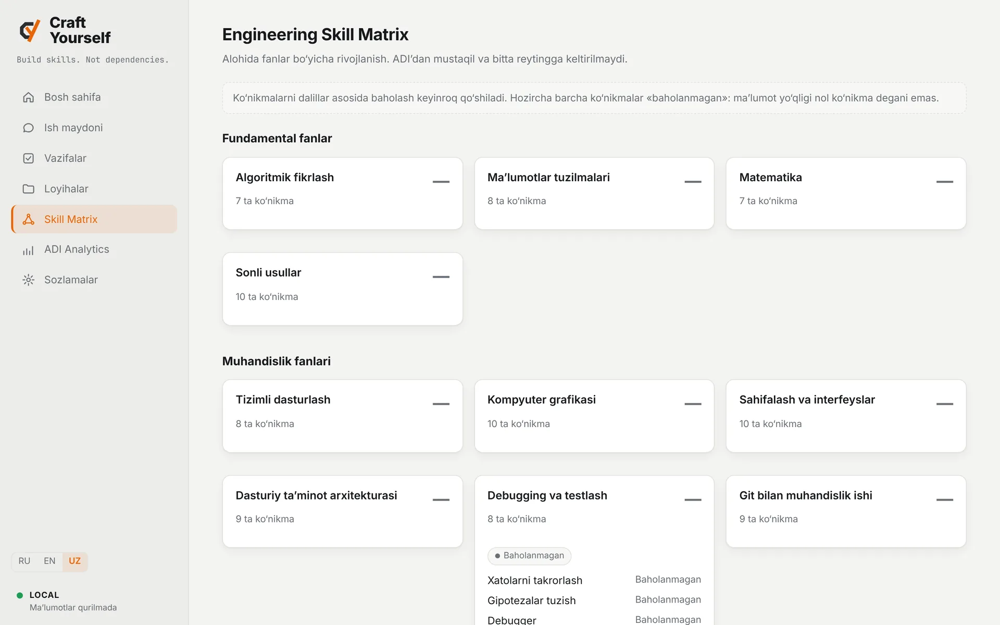

<p align="center"></p>

<p align="center"><a href="README.md">English</a> · <a href="README.ru.md">Русский</a> · <b>O‘zbekcha</b></p>

# Craft Yourself

Muhandislik ko‘nikmalari uchun ochiq kodli trenajyor: haqiqiy loyihalar va
Issue’lar, o‘zingizning IDE’ngiz va **siz uchun yechmaydigan, balki fikrlashga
yordam beradigan** AI-mentor bilan chat.

> **Build skills. Not dependencies.**

Arxitektura: [`docs/architecture.md`](docs/architecture.md) (TZ v0.3) ·
Reja: [`ROADMAP.md`](ROADMAP.md) · AI-agentlar uchun: [`AGENTS.md`](AGENTS.md) ·
Interfeys konseptlari: [`docs/design/`](docs/design)

## Skrinshotlar

**Bosh sahifa: o‘quv dasturlari.** Birinchi dastur mavjud, qolganlari — «tez orada».



**Chatdagi Issue.** L0 da mentor savollar beradi va qabul mezonlarini tuzadi; to‘liq yechim so‘rovi bloklangan va bir pog‘onaga oshirish taklif qilingan; testlar Docker sandboxida o‘tdi.


<table>
<tr>
<td width="50%">Mentor javobidan saqlangan <b>qabul mezonlari</b> va nazorat ro‘yxati.<br></td>
<td width="50%">Izolyatsiyalangan freymdagi <b>chegaraviy qiymatlar trenajyori</b>: 5000 uchun noto‘g‘ri kutilgan qiymat aniqlandi.<br></td>
</tr>
<tr>
<td colspan="2">Yorug‘ mavzudagi <b>Engineering Skill Matrix</b>: tekshirilmagan ko‘nikmalar nol emas, «baholanmagan».<br></td>
</tr>
</table>

## Hozir nima ishlaydi

- **O‘quv dasturlari.** Dasturlar plitkalari bilan bosh sahifa. Birinchi
  dastur — «Testlar: ishga tushirish va sifat»: nazariya, serverda
  tekshiriladigan savollar, izolyatsiyalangan iframe’dagi chegaraviy
  qiymatlar trenajyori va sandboxda ishga tushiriladigan amaliy loyiha
  (regressiya testi, qizil → yashil). Yana oltita dastur «tez orada» deb belgilangan.
- **Masalalar tahlili (LeetCode, Codeforces).** Havola, shart va misollarni
  joylashtiring va Python, C++ yoki Rust’ni tanlang: yechim shabloni bilan ish
  katalogi yaratiladi, misollar sandboxda ishga tushiriladi, mentor esa
  bosqichma-bosqich olib boradi — shart, misollar, g‘oya, murakkablik,
  chegaraviy holatlar — L0 dan boshlab, javob o‘rniga savollar bilan. Sizning
  ruxsatingiz bilan EST shart, misollar, teglar va reytingni Codeforces yoki
  LeetCode’dan o‘zi yuklaydi; boshlashdan oldin ularni tekshirasiz.
- **Tavsiyalar.** Ulangan sun’iy intellekt faolligingiz asosida keyingi
  qadamlarni taklif qiladi: qaysi dasturlarni tugatish, qaysi Issue’larga
  qaytish, Codeforces yoki LeetCode’da mavzu va reyting bo‘yicha qaysi
  masalalarni yechish, qaysi dasturni yaratish. Model faqat umumlashgan
  ma’lumotlar va nomlarni ko‘radi — xabarlar va kodni hech qachon — va nima
  yuborilishini ko‘rishingiz mumkin.
- **Sessiya xulosalari va bilim profili.** Issue yakunlanganda yoki
  to‘xtatilganda kod kuzatilgan hodisalar bo‘yicha sessiya xulosasini tuzadi:
  yordam darajalari, sandboxdagi testlar, qabul mezonlari, o‘z commitlari,
  yakuniy ADI va «mustaqil» yoki «testlar tuzatildi» kabi signallar. Bilim
  profili ularni fanlar, masala teglari va vazifa turlari bo‘yicha jamlaydi
  («mustaqil», «rivojlanmoqda», «mashq kerak») va tavsiyalarga uzatadi. Bu
  baho emas, maslahat: ADI va Skill Matrix mustaqil qoladi.
- **So‘rov bo‘yicha dasturlar.** Mavzu, daraja va darslar sonini kiriting —
  ulangan sun’iy intellekt reja tuzadi va darslar, interaktiv HTML5 sahifalar
  hamda testlar yozadi. Model javoblari saqlashdan oldin kodda tekshiriladi,
  testlar serverda baholanadi, natijalar o‘rnatilgan dasturlardagidek hisobga olinadi.
- **Jonli javoblar.** Mentor javobi model uni yozayotgan paytda paydo
  bo‘ladi. Oldindan faqat siyosat hech qachon olib tashlamaydigan matn
  ko‘rsatiladi: kod bloklari va HTML sahifalar butun javob tekshirilgach.
- **Sun’iy intellektdan formulalar va sahifalar.** LaTeX (`$…$`, `$$…$$`)
  darslarda, testlarda va chatda KaTeX orqali ko‘rsatiladi. Mentor biriktirgan
  HTML5 sahifa (```` ```html ```` bloki) tarmoqsiz va ilovaga kirishsiz
  izolyatsiyalangan freymda ko‘rsatiladi; siyosat har bir javobda bitta
  sahifaga L2 darajasidan boshlab ruxsat beradi, undan pastda sahifalar olib
  tashlanadi. Animatsiyalar, canvas, formalar va sahifa ichidagi xabarlar
  ishlaydi; ma’lumotlar sahifa ochiq turganda saqlanadi.
- **Open source Issue’lari.** GitHub yoki GitLab Issue havolasini joylashtiring
  va EST’ga uni o‘qishga ruxsat bering: qat’iy qoidalar uning o‘quvchiga mosligini
  tekshiradi (yopilgan Issue’lar, pull request’lar, arxivlangan repozitoriylar va
  rad etilgan belgilar qabul qilinmaydi; ijrochi, qisqa tavsif yoki uzun muhokama
  belgilanadi; *good first issue* va chek-listlar uning foydasiga). Import
  repozitoriyni ulaydi va vazifa yaratadi — tur va murakkablik belgilardan,
  chek-list qabul mezonlari sifatida — u boshqalari kabi L0 dan boshlanadi.
- **Ruxsatingizsiz hech narsa chiqmaydi.** Platforma yoki masalalar saytidan
  o‘qish shu so‘rov uchun belgi talab qiladi; nashr (Issue’ingizga izoh) har
  doim avval qoralama bo‘lib, nima va qayerga ketishini ko‘rsatadi va faqat shu
  qoralamani tasdiqlaganingizda yuboriladi. Mentor buning hech birini qila
  olmaydi. Tokenlar `config.toml` dagi `[remote]` da nomlangan muhit
  o‘zgaruvchilaridan olinadi.
- **Loyihalar va ish kataloglari.** Mahalliy Git repozitoriyni ulash (yoki
  masofaviyni klonlash), tillar va litsenziyani aniqlash, har bir Issue uchun
  `~/.est/workspaces` ichida alohida katalog va tarmoq, muharrirda ochish.
- **Sandbox.** Testlar, tekshiruvlar va o‘z buyruqlaringiz Docker yoki
  Podman’da bajariladi: siz ruxsat bermaguningizcha tarmoqsiz, CPU, xotira,
  jarayonlar va vaqt cheklovlari bilan, capabilities’siz, ildiz fayl tizimi
  faqat o‘qish uchun; ish katalogingiz faqat o‘qish uchun ulanadi. Natijalar
  chatda va «Testlar» yorlig‘ida ko‘rinadi.
- **Chat-first mentor va L0–L4 darajalari.** Har bir yangi Issue L0
  (sokratik) darajadan boshlanadi. Joriy darajadan yuqori so‘rov bloklanadi va
  mentor darajani **bir** pog‘onaga oshirishni taklif qiladi; roziliksiz hech
  narsa ochilmaydi. L0 da ham mentor **qabul mezonlarini** tuzadi va matnni
  **tarjima qiladi**. Cheklovlar kodda tekshiriladi: ortiqcha kod javobdan olib tashlanadi.
- **Documentation Boundary.** Aniq API haqidagi savollar modelga bormaydi:
  javob — manba kodidagi ta’rifga, vazifa hujjatlariga va API Reference’ga havolalar.
- **AI Gateway.** API kaliti orqali Claude, ChatGPT, Gemini, DeepSeek, Kimi va
  Qwen, kodlash rejalari obunalari (Kimi Code, Qwen Coding Plan), mahalliy
  Ollama yoki istalgan OpenAI-mos API — «Sozlamalar → Neyrotarmoqlar» bo‘limida
  ulanadi va almashtiriladi. Tashqi provayderlar faqat https; kalitlar
  qurilmada (`~/.est/secrets`, faqat egasiga ruxsat) yoki muhit o‘zgaruvchisidan olinadi.
- **ADI va Skill Matrix.** Har bir yakunlangan Issue bo‘yicha AI’ga
  bog‘liqlik indeksi kuzatilgan hodisalar asosida hisoblanadi va ikki marta
  so‘nish bilan o‘rtachalanadi (30 kun / 10 Issue). Engineering Skill Matrix
  ko‘nikmalarni kuzatilgan dalillar bo‘yicha baholaydi — test urinishlari,
  trenajyor natijalari, yakunlangan amaliyot va Issue’lar (testlar, qabul
  mezonlari, yordam darajalari) — holat, ishonchlilik, o‘lchovlar (nazariya,
  amaliyot, diagnostika, mustaqillik) va tarix bilan. Darslarni o‘qish dalil
  hisoblanmaydi, tekshirilmagan ko‘nikma 0 emas, «baholanmagan». Ular mustaqil:
  ADI bahoga kirmaydi.
- **Desktop ilova (Tauri)** Linux, Windows va macOS uchun; xuddi shu interfeys brauzerda ham ishlaydi.
- **Interfeys rus, ingliz va o‘zbek tillarida**; qorong‘i va yorug‘ mavzular.
- **Maxfiylik.** Ma’lumotlar mahalliy; butun tarixni JSON’ga eksport qilish;
  suhbatni hodisalari va vazifa ADI’si bilan birga o‘chirish.

Hozircha yo‘q: kommit va PR tekshiruvi hamda pull request’larni nashr qilish,
model ishtirokidagi ADI, qolgan o‘quv dasturlari.
[ROADMAP.md](ROADMAP.md) ga qarang.

## Tez boshlash

Craft Yourself — [Tauri](https://tauri.app) asosidagi **desktop ilova**: bitta
oyna ichida mahalliy demon (ma’lumotlar bazasi, sandbox, mentor) va interfeys.
Rust ≥ 1.90, `git`, Node.js 22 va testlarni sandboxda ishga tushirish uchun
Podman yoki Docker kerak. Linux’da Tauri uchun WebKitGTK ham kerak:
`sudo apt install libwebkit2gtk-4.1-dev libgtk-3-dev libsoup-3.0-dev librsvg2-dev`.

```sh
(cd frontend && npm ci && npm run build)          # interfeys ilovaga joylashtiriladi
cargo run --release --manifest-path apps/desktop/Cargo.toml
```

O‘rnatuvchilar (`.deb`, `.AppImage`, `.msi`, `.dmg`): `cargo install tauri-cli --version "^2"`,
so‘ng `apps/desktop` ichida `cargo tauri build`.

Bosh sahifada «Testlar» dasturini tanlang va birinchi darsdan boshlang.

Grafik seanssiz (server, WSL) xuddi shu demon interfeysni brauzerga beradi:
`cargo run -p est-cli -- serve` → http://127.0.0.1:7878. Modelni «Sozlamalar → Neyrotarmoqlar» bo‘limida yoki `~/.est/config/config.toml` faylida ulang:

```toml
[llm]
base_url = "http://127.0.0.1:11434/v1"   # Ollama
model = "qwen2.5-coder:7b"
```

### CLI

```sh
est project add ~/src/my-project
est task import exercises/examples/globset-escape-roundtrip.toml
est task start <id> --open          # ish katalogi + IDE
cd "$(est workspace path)"
est chat "escape funksiyasini topdim, keyin nimani tekshiray?"
est escalation accept               # yoki reject
est test                            # testlar sandboxda
est task complete <id>              # yakuniy ADI
est adi
est data export --output history.json
```

## Ishlab chiqish

```sh
cargo test --workspace
cargo clippy --workspace --all-targets -- -D warnings
cargo fmt --all
cd frontend && npm run dev           # http://localhost:5173 → API :7878 da
cd apps/desktop && cargo clippy -- -D warnings   # desktop ilova (WebKitGTK kerak)
EST_SANDBOX_IT=1 cargo test -p est-sandbox   # haqiqiy konteynerda izolyatsiya testi
```

## Litsenziya

[LICENSE](LICENSE) fayli — GPL-3.0. TZ v0.3 da loyiha litsenziyasi TBD deb
belgilangan; yakuniy tanlov repozitoriy egasiga tegishli.
