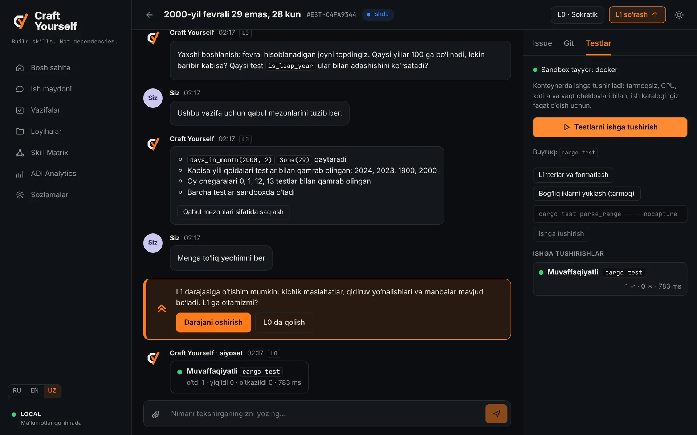

<p align="center"></p>

<p align="center"><a href="README.md">English</a> · <a href="README.ru.md">Русский</a> · <b>O‘zbekcha</b></p>

# Craft Yourself

Muhandislik ko‘nikmalari uchun ochiq kodli trenajyor: haqiqiy loyihalar va
Issue’lar, o‘zingizning IDE’ngiz va **siz uchun yechmaydigan, balki fikrlashga
yordam beradigan** AI-mentor bilan chat.

> **Build skills. Not dependencies.**

Arxitektura: [`docs/architecture.md`](docs/architecture.md) (TZ v0.3) ·
Reja: [`ROADMAP.md`](ROADMAP.md) · AI-agentlar uchun: [`AGENTS.md`](AGENTS.md) ·
Interfeys konseptlari: [`docs/design/`](docs/design)

## Skrinshotlar

**Bosh sahifa: o‘quv dasturlari.** Birinchi dastur mavjud, qolganlari — «tez orada».


**Chatdagi Issue.** L0 da mentor savollar beradi va qabul mezonlarini tuzadi; to‘liq yechim so‘rovi bloklangan va bir pog‘onaga oshirish taklif qilingan; testlar Docker sandboxida o‘tdi.



<table>
<tr>
<td width="50%">Mentor javobidan saqlangan <b>qabul mezonlari</b> va nazorat ro‘yxati.<br></td>
<td width="50%">Izolyatsiyalangan freymdagi <b>chegaraviy qiymatlar trenajyori</b>: 5000 uchun noto‘g‘ri kutilgan qiymat aniqlandi.<br></td>
</tr>
<tr>
<td colspan="2">Yorug‘ mavzudagi <b>Engineering Skill Matrix</b>: tekshirilmagan ko‘nikmalar nol emas, «baholanmagan».<br></td>
</tr>
</table>

## Hozir nima ishlaydi

- **O‘quv dasturlari.** Dasturlar plitkalari bilan bosh sahifa. Birinchi
  dastur — «Testlar: ishga tushirish va sifat»: nazariya, serverda
  tekshiriladigan savollar, izolyatsiyalangan iframe’dagi chegaraviy
  qiymatlar trenajyori va sandboxda ishga tushiriladigan amaliy loyiha
  (regressiya testi, qizil → yashil). Yana oltita dastur «tez orada» deb belgilangan.
- **Loyihalar va ish kataloglari.** Mahalliy Git repozitoriyni ulash (yoki
  masofaviyni klonlash), tillar va litsenziyani aniqlash, har bir Issue uchun
  `~/.est/workspaces` ichida alohida katalog va tarmoq, muharrirda ochish.
- **Sandbox.** Testlar, tekshiruvlar va o‘z buyruqlaringiz Docker yoki
  Podman’da bajariladi: siz ruxsat bermaguningizcha tarmoqsiz, CPU, xotira,
  jarayonlar va vaqt cheklovlari bilan, capabilities’siz, ildiz fayl tizimi
  faqat o‘qish uchun; ish katalogingiz faqat o‘qish uchun ulanadi. Natijalar
  chatda va «Testlar» yorlig‘ida ko‘rinadi.
- **Chat-first mentor va L0–L4 darajalari.** Har bir yangi Issue L0
  (sokratik) darajadan boshlanadi. Joriy darajadan yuqori so‘rov bloklanadi va
  mentor darajani **bir** pog‘onaga oshirishni taklif qiladi; roziliksiz hech
  narsa ochilmaydi. L0 da ham mentor **qabul mezonlarini** tuzadi va matnni
  **tarjima qiladi**. Cheklovlar kodda tekshiriladi: ortiqcha kod javobdan olib tashlanadi.
- **Documentation Boundary.** Aniq API haqidagi savollar modelga bormaydi:
  javob — manba kodidagi ta’rifga, vazifa hujjatlariga va API Reference’ga havolalar.
- **AI Gateway.** Istalgan OpenAI-mos endpoint: mahalliy Ollama, llama.cpp
  server yoki tashqi API (faqat https, kalit muhit o‘zgaruvchisidan).
- **ADI va Skill Matrix.** Har bir yakunlangan Issue bo‘yicha AI’ga
  bog‘liqlik indeksi kuzatilgan hodisalar asosida hisoblanadi va ikki marta
  so‘nish bilan o‘rtachalanadi (30 kun / 10 Issue). Engineering Skill Matrix
  tekshirilmagan ko‘nikmani 0 emas, «baholanmagan» deb ko‘rsatadi. Ular mustaqil.
- **Interfeys rus, ingliz va o‘zbek tillarida**; qorong‘i va yorug‘ mavzular.
- **Maxfiylik.** Ma’lumotlar mahalliy; butun tarixni JSON’ga eksport qilish;
  suhbatni hodisalari va vazifa ADI’si bilan birga o‘chirish.

Hozircha yo‘q: Session Summary va Knowledge Profile, dalillar asosida
ko‘nikmalarni baholash, kommit va PR tekshiruvi, qolgan o‘quv dasturlari.
[ROADMAP.md](ROADMAP.md) ga qarang.

## Tez boshlash

Rust ≥ 1.85, `git`, Node.js 22 (interfeys uchun) va testlarni sandboxda
ishga tushirish uchun Podman yoki Docker kerak.

```sh
cargo build --release
(cd frontend && npm ci && npm run build)

./target/release/est init                    # ~/.est va config.toml
./target/release/est serve                   # http://127.0.0.1:7878
```

Manzilni oching, bosh sahifada «Testlar» dasturini tanlang va birinchi
darsdan boshlang. Modelni `~/.est/config/config.toml` faylida ulang:

```toml
[llm]
base_url = "http://127.0.0.1:11434/v1"   # Ollama
model = "qwen2.5-coder:7b"
```

### CLI

```sh
est project add ~/src/my-project
est task import exercises/examples/globset-escape-roundtrip.toml
est task start <id> --open          # ish katalogi + IDE
cd "$(est workspace path)"
est chat "escape funksiyasini topdim, keyin nimani tekshiray?"
est escalation accept               # yoki reject
est test                            # testlar sandboxda
est task complete <id>              # yakuniy ADI
est adi
est data export --output history.json
```

## Ishlab chiqish

```sh
cargo test --workspace
cargo clippy --workspace --all-targets -- -D warnings
cargo fmt --all
cd frontend && npm run dev           # http://localhost:5173 → API :7878 da
EST_SANDBOX_IT=1 cargo test -p est-sandbox   # haqiqiy konteynerda izolyatsiya testi
```

## Litsenziya

[LICENSE](LICENSE) fayli — GPL-3.0. TZ v0.3 da loyiha litsenziyasi TBD deb
belgilangan; yakuniy tanlov repozitoriy egasiga tegishli.
