<!-- Generated by `cargo run -p est-roadmap -- render` from roadmap/*.toml. Do not edit: change the data and render again. -->

# Dependencies

[↑ ROADMAP.md](../../ROADMAP.md) · [Product Roadmap](product.md) · [Technical Roadmap](technical.md) · [Learning Roadmap](learning.md) · [Research Roadmap](research.md) · [Infrastructure & Security Roadmap](infrastructure.md) · [Release Roadmap](releases.md) · **Dependencies** · [Metrics](metrics.md)

Arrows go from a dependency to the work that needs it (`depends_on`, and `blocks` read backwards). Only edges that touch open work are drawn; `cargo run -p est-roadmap -- graph --all` prints every edge, `--format dot` prints Graphviz.

```mermaid
flowchart LR
  INF_004["INF-004<br/>Desktop distribution"]:::proposed
  INF_017["INF-017<br/>Prepared tests and sample runner"]:::done
  INF_018["INF-018<br/>Hidden, edge-case, invalid-input and stress suites"]:::proposed
  INF_019["INF-019<br/>Reference implementation comparison"]:::proposed
  INF_020["INF-020<br/>Property-based testing harness"]:::proposed
  INF_021["INF-021<br/>Complexity analysis"]:::proposed
  INF_023["INF-023<br/>Git integration of checks"]:::proposed
  INF_038["INF-038<br/>Performance budgets"]:::proposed
  LRN_014["LRN-014<br/>Help accounting per evidence"]:::ready
  LRN_015["LRN-015<br/>Competency graph content"]:::planned
  LRN_019["LRN-019<br/>Retention model"]:::proposed
  LRN_020["LRN-020<br/>Forgetting signals and reassessment triggers"]:::proposed
  LRN_021["LRN-021<br/>Review scheduling policy"]:::proposed
  LRN_023["LRN-023<br/>Adaptive difficulty"]:::proposed
  LRN_024["LRN-024<br/>Hint budget"]:::proposed
  LRN_025["LRN-025<br/>Learning path generator"]:::proposed
  LRN_026["LRN-026<br/>Learning bottleneck detection"]:::proposed
  LRN_029["LRN-029<br/>Error taxonomy"]:::proposed
  LRN_030["LRN-030<br/>Systematic versus random errors"]:::proposed
  LRN_031["LRN-031<br/>Corrective tasks and correction history"]:::proposed
  PRD_021["PRD-021<br/>Installers, auto-update and tray"]:::proposed
  PRD_024["PRD-024<br/>Discovery: GitLab, skipped suggestions, ranking"]:::proposed
  PRD_033["PRD-033<br/>Recommendation and trajectory rationale"]:::proposed
  PRD_035["PRD-035<br/>Extended learning profile"]:::proposed
  PRD_036["PRD-036<br/>Goal management"]:::proposed
  PRD_038["PRD-038<br/>Reflection stage"]:::proposed
  PRD_039["PRD-039<br/>Learning journal"]:::proposed
  PRD_040["PRD-040<br/>Confidence before control tasks"]:::proposed
  PRD_042["PRD-042<br/>Learning path view"]:::proposed
  PRD_043["PRD-043<br/>Review queue"]:::proposed
  PRD_045["PRD-045<br/>Structured progress export"]:::proposed
  TEC_012["TEC-012<br/>Evidence record in the domain"]:::ready
  TEC_013["TEC-013<br/>Evidence derivation from observed events"]:::planned
  TEC_014["TEC-014<br/>Persistent evidence store"]:::planned
  TEC_015["TEC-015<br/>Backfill evidence from existing data"]:::planned
  TEC_016["TEC-016<br/>Assessment explanation API"]:::planned
  TEC_018["TEC-018<br/>Provenance of assessments"]:::planned
  TEC_019["TEC-019<br/>Versioned scoring rules"]:::planned
  TEC_020["TEC-020<br/>Reproducible task snapshots"]:::proposed
  TEC_022["TEC-022<br/>Graph model and catalog as data"]:::planned
  TEC_023["TEC-023<br/>Graph validation"]:::planned
  TEC_024["TEC-024<br/>Gap queries"]:::planned
  TEC_025["TEC-025<br/>Competency graph API and view"]:::proposed
  TEC_027["TEC-027<br/>Lifecycle stages"]:::planned
  TEC_028["TEC-028<br/>Issue validation"]:::planned
  TEC_029["TEC-029<br/>Prerequisite check"]:::planned
  TEC_030["TEC-030<br/>Issue dependencies and branching"]:::proposed
  TEC_031["TEC-031<br/>Issue replay with history"]:::proposed
  TEC_032["TEC-032<br/>Dynamic Issue generation from gaps"]:::proposed
  TEC_033["TEC-033<br/>Issue schema"]:::proposed
  TEC_042["TEC-042<br/>Crate est-adaptive"]:::proposed
  TEC_043["TEC-043<br/>Trajectory log"]:::proposed
  TEC_044["TEC-044<br/>Review scheduler"]:::proposed
  TEC_046["TEC-046<br/>Reflection answers"]:::proposed
  TEC_047["TEC-047<br/>Confidence records"]:::proposed
  TEC_048["TEC-048<br/>Journal projection"]:::proposed
  TEC_049["TEC-049<br/>Solution comparison model"]:::proposed
  TEC_050["TEC-050<br/>Hint budget in the policy engine"]:::proposed
  TEC_051["TEC-051<br/>Misconception detector"]:::proposed
  TEC_052["TEC-052<br/>Transfer assessment v2"]:::proposed
  TEC_065["TEC-065<br/>Generated programs give no skill evidence"]:::proposed
  INF_004 --> PRD_021
  INF_017 --> INF_018
  INF_017 --> INF_023
  INF_018 --> INF_019
  INF_018 --> INF_021
  INF_019 --> INF_020
  LRN_014 --> LRN_024
  LRN_019 --> LRN_020
  LRN_019 --> LRN_021
  LRN_019 --> LRN_023
  LRN_020 --> LRN_025
  LRN_023 --> LRN_025
  LRN_025 --> TEC_032
  LRN_029 --> LRN_030
  LRN_030 --> LRN_031
  TEC_012 --> TEC_013
  TEC_012 --> TEC_014
  TEC_012 --> TEC_050
  TEC_013 --> TEC_015
  TEC_014 --> INF_038
  TEC_014 --> LRN_019
  TEC_014 --> LRN_023
  TEC_014 --> PRD_035
  TEC_014 --> TEC_015
  TEC_014 --> TEC_016
  TEC_014 --> TEC_018
  TEC_014 --> TEC_024
  TEC_014 --> TEC_031
  TEC_014 --> TEC_047
  TEC_014 --> TEC_048
  TEC_014 --> TEC_051
  TEC_018 --> PRD_045
  TEC_018 --> TEC_016
  TEC_018 --> TEC_019
  TEC_019 --> TEC_020
  TEC_020 --> TEC_052
  TEC_022 --> LRN_015
  TEC_022 --> PRD_036
  TEC_022 --> TEC_023
  TEC_022 --> TEC_024
  TEC_022 --> TEC_051
  TEC_022 --> TEC_052
  TEC_022 --> TEC_065
  TEC_024 --> LRN_025
  TEC_024 --> LRN_026
  TEC_024 --> PRD_024
  TEC_024 --> TEC_025
  TEC_024 --> TEC_029
  TEC_024 --> TEC_042
  TEC_027 --> TEC_028
  TEC_027 --> TEC_029
  TEC_027 --> TEC_030
  TEC_027 --> TEC_031
  TEC_027 --> TEC_033
  TEC_027 --> TEC_044
  TEC_027 --> TEC_046
  TEC_027 --> TEC_049
  TEC_028 --> TEC_032
  TEC_042 --> PRD_042
  TEC_042 --> TEC_043
  TEC_042 --> TEC_044
  TEC_043 --> PRD_033
  TEC_043 --> PRD_042
  TEC_044 --> PRD_043
  TEC_046 --> PRD_038
  TEC_046 --> TEC_048
  TEC_047 --> PRD_040
  TEC_048 --> PRD_039
  classDef done fill:#d4edda,stroke:#2e7d32,color:#1b3d1f
  classDef inprogress fill:#fff3cd,stroke:#b58900,color:#3d2f00
  classDef inreview fill:#fff3cd,stroke:#b58900,color:#3d2f00
  classDef blocked fill:#f8d7da,stroke:#c62828,color:#4a1015
  classDef ready fill:#dbeafe,stroke:#1d4ed8,color:#10204a
  classDef planned fill:#eef0f3,stroke:#6b7280,color:#1f2937
  classDef proposed fill:#ffffff,stroke:#9ca3af,color:#374151,stroke-dasharray:4 3
  classDef deferred fill:#eef0f3,stroke:#9ca3af,color:#6b7280
  classDef cancelled fill:#eef0f3,stroke:#9ca3af,color:#9ca3af
```

## Cycles

None.

## Bottlenecks

Open items that the most open work waits for, directly or transitively.

| Item | Status | Open work waiting |
|---|---|---|
| [TEC-012](technical.md#tec-012) Evidence record in the domain | ▶ Ready | 35 |
| [TEC-014](technical.md#tec-014) Persistent evidence store | ◯ Planned | 32 |
| [TEC-022](technical.md#tec-022) Graph model and catalog as data | ◯ Planned | 19 |
| [TEC-027](technical.md#tec-027) Lifecycle stages | ◯ Planned | 13 |
| [TEC-024](technical.md#tec-024) Gap queries | ◯ Planned | 12 |
| [LRN-019](learning.md#lrn-019) Retention model | ◯ Proposed | 5 |
| [TEC-018](technical.md#tec-018) Provenance of assessments | ◯ Planned | 5 |
| [TEC-042](technical.md#tec-042) Crate est-adaptive | ◯ Proposed | 5 |
| [INF-018](infrastructure.md#inf-018) Hidden, edge-case, invalid-input and stress suites | ◯ Proposed | 3 |
| [TEC-046](technical.md#tec-046) Reflection answers | ◯ Proposed | 3 |
| [LRN-020](learning.md#lrn-020) Forgetting signals and reassessment triggers | ◯ Proposed | 2 |
| [LRN-023](learning.md#lrn-023) Adaptive difficulty | ◯ Proposed | 2 |
| [LRN-029](learning.md#lrn-029) Error taxonomy | ◯ Proposed | 2 |
| [TEC-019](technical.md#tec-019) Versioned scoring rules | ◯ Planned | 2 |
| [TEC-043](technical.md#tec-043) Trajectory log | ◯ Proposed | 2 |
